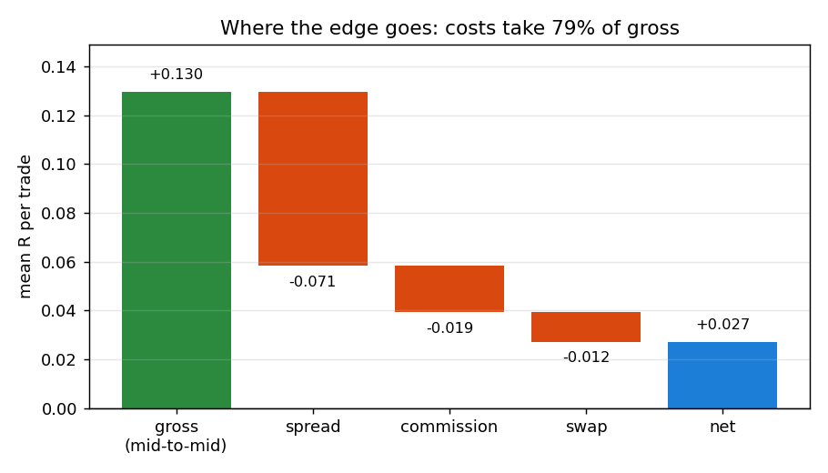
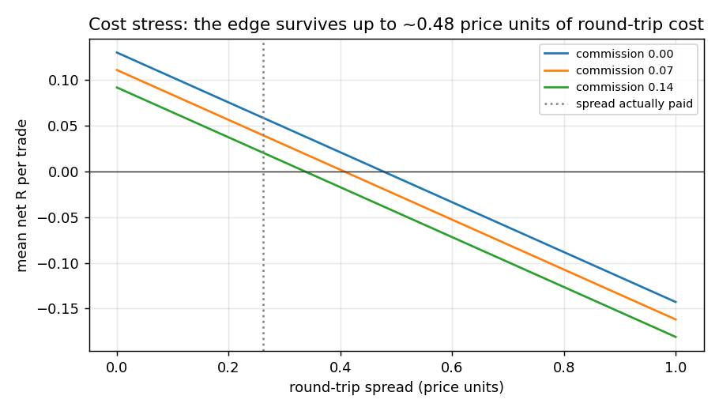
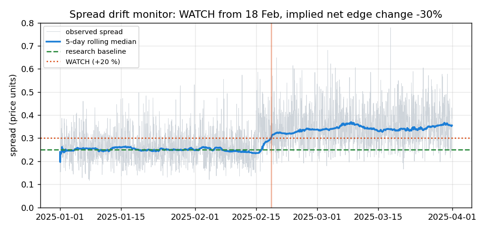

# costaudit: how much of your edge do the costs really take?

[](https://github.com/Tolbert-Okoth/trading-cost-audit/actions/workflows/tests.yml)


Backtests and broker statements usually report **net** P&L from fills, which buries the cost. Two things then go wrong:
- **You cannot tell a weak strategy from an expensive one.**
- **Research ledgers built on one data feed quietly assume that feed's spreads.** Moving to a broker with wider ones changes the answer.

`costaudit` gives you five tools, all on a plain trade ledger:
- **`gross_from_fills`:** rebuilds the **mid-to-mid gross** result of every trade from its fills and itemises spread, commission and swap in R.
- **`breakeven_cost`:** the round-trip cost at which the strategy stops making money.
- **`cost_grid`:** stresses the edge across spread and commission scenarios (a different broker, account type or session).
- **`speed_limit`:** applies Carver's rule of thumb: annual cost Sharpe should be at most ⅓ of gross Sharpe.
- **`spread_drift`:** watches **live spreads** against the spread your research assumed. It flags drift and says what it does to net edge.



## What the demo shows (synthetic ledger of 2,000 trades, `python examples/headline.py`)
| Measure | Value |
|---|---|
| Gross edge (mid-to-mid) | +0.130 R / trade |
| Spread · commission · swap | 0.071 · 0.019 · 0.012 R |
| **Net edge** | **+0.027 R / trade (costs take 79 %)** |
| Breakeven round-trip cost | 0.48 price units, versus about 0.26 actually paid |
| Speed limit (cost SR / gross SR) | 0.79 > ⅓ → **fails**: the strategy trades too often for its edge |

A strategy that looks marginal on net may be a solid gross edge that is too expensive to trade. That diagnosis points to a different fix: fewer trades, a cheaper venue or account, or limit entries rather than a new signal.





The drift monitor compares a rolling median of observed spreads against the research baseline. In the demo, a regime change raises spreads about 35 %. The monitor flags **WATCH** within three days and estimates the hit to net edge at **−30 %**, before it shows up in P&L.

## Why I built it
- **A cost audit on my own live/demo strategies found that the research ledgers understated costs by about 0.05 R per trade.** The cause was a data-feed spread assumption that did not match the execution venue.
  - The edge survived.
  - An earlier claim that "costs take most of the edge" turned out to be an artefact of mixing ledgers from two venues.
- The same audit is now a standing check: rebuild gross, cost it at the venue's real spreads, and monitor drift live.

## Quick start
```bash
pip install "git+https://github.com/Tolbert-Okoth/trading-cost-audit.git#egg=costaudit[plot]"
```
```python
import pandas as pd, costaudit as ca

# your ledger: side (+1/-1), entry_fill, exit_fill, spread_entry, spread_exit, risk (1R in price units),
# optional commission and swap (price units, positive = cost)
trades = pd.read_csv("my_trades.csv")
g = ca.gross_from_fills(trades)
print(g.mean())                                             # gross_R, spread_R, commission_R, swap_R, cost_R, net_R
print(ca.breakeven_cost(g.gross_R, trades.risk))
print(ca.cost_grid(g.gross_R, trades.risk, spreads=[0.1, 0.2, 0.4], commissions=[0, 0.07]))
print(ca.speed_limit(g.gross_R, g.cost_R, trades_per_year=250))

live = pd.read_csv("observed_spreads.csv", index_col=0, parse_dates=True)["spread"]
flags = ca.spread_drift(live, baseline=0.25, window="5D", watch_mult=1.2, gross_R_per_trade=0.13, risk=4.0)
```

## API
| Function | Returns |
|---|---|
| `gross_from_fills(trades, commission_col, swap_col)` | Per-trade `gross_R`, `spread_R`, `commission_R`, `swap_R`, `cost_R`, `net_R` |
| `breakeven_cost(gross_R, risk)` | Round-trip cost (price units) that zeroes the mean net R |
| `cost_grid(gross_R, risk, spreads, commissions)` | Mean net R/trade table, spreads × commissions |
| `speed_limit(gross_R, cost_R, trades_per_year, limit=1/3)` | Gross and cost Sharpe, cost share, ratio and pass flag |
| `spread_drift(spreads, baseline, window, watch_mult, gross_R_per_trade, risk)` | Rolling median, OK/WATCH status and implied net edge change |

## Who this is for
- **Retail and prop-firm traders:** choosing between brokers or account types, or checking whether a strategy is worth running at all.
- **Quant researchers:** separating signal quality from execution cost before tuning anything.
- **Teams and clients:** I offer cost and execution audits of strategy ledgers using this toolkit. Contact via my GitHub profile.

## Data and licensing
- **This repository contains no market or broker data.** Every figure comes from a synthetic ledger generated by `examples/headline.py`.
- Use the tools with your own ledgers and data you are licensed to use. Nothing here downloads or redistributes vendor data.
- Code: MIT License (see `LICENSE`).

## References
- Carver, R. (2015). *Systematic Trading*, Harriman House: the "speed limit" on trading costs.
- Harris, L. (2003). *Trading and Exchanges*, Oxford University Press: on spreads as the price of immediacy.

## Disclaimer
Research and educational software. Not investment advice, and no warranty: see `LICENSE`.
